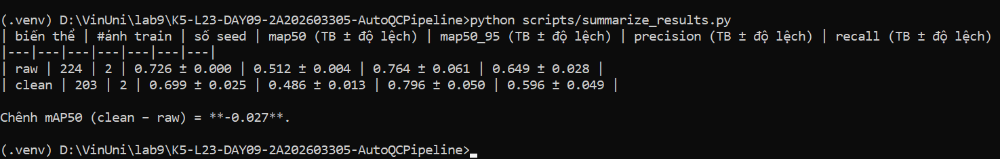

# Báo cáo Day 09 — Lâm Hoài Kim Ngân, 2A202603305
# Link Colab: 
https://colab.research.google.com/github/nganlam-vn/K5-L23-DAY09-2A202603305-AutoQCPipeline/blob/main/notebooks/day09_train_compare.ipynb
## 1. Kết luận trước
Pipeline đưa ra kết luận: **HOLD** (mã thoát 10). 
- Số lượng ảnh đầu vào: **224 ảnh** từ `data/raw/images`.
- Số lượng ảnh đầu ra dataset: **203 ảnh** được xuất vào `submission/export/clean_v1`.
- Lý do chính: Ở cửa vào (Intake), pipeline đã loại bỏ 21 ảnh lỗi (ảnh hỏng, kích thước nhỏ < 250px, ảnh trùng byte, ảnh gần trùng qua pHash và ảnh rò rỉ tập test). Sau khi máy tự động sửa các lỗi cú pháp an toàn và người duyệt mô phỏng 80 ảnh đầu hàng đợi, pipeline không còn bất kỳ lỗi bắt buộc nào (0 ERROR). Tuy nhiên, tỉ lệ ảnh còn cảnh báo là **18.72%** (38/203 ảnh), vượt ngưỡng trần 10.00% (`warn_ratio_hold = 0.10`) do ngân sách duyệt (80 ảnh) chưa đủ để bao quát hết 125 ảnh có cảnh báo. Vì vậy lô dữ liệu được giữ lại để tiếp tục xem xét (Hold), chưa được phát hành chính thức (Release).

## 2. Lỗi và phân việc
Thống kê lỗi từ `02_error_list_v1` (tổng hợp trước khi sửa):

| Mã lỗi | Số ảnh/dòng | Ai sửa (máy/người) | Vì sao |
|---|---:|---|---|
| `BAD_CLASS_ID` | 6 dòng | Máy (autofix) | ID lớp ngoài 0..3 (vd: -1, 4, 7, 93), sai cú pháp rõ ràng, máy tự xóa dòng an toàn (`drop_line`). |
| `BAD_CLASS_NAME` | 2 lỗi | Máy (autofix) | Tên lớp trong `data.yaml` viết hoa/lệch ('Person', 'Bus'), máy chuẩn hóa về `['car', 'person', 'truck', 'bus']` (`rename_classes`). |
| `BAD_FORMAT` | 3 dòng | Máy (autofix) | Dòng thiếu cột hoặc chứa giá trị NaN, sai định dạng YOLO bắt buộc máy phải xóa (`drop_line`). |
| `BAD_SIZE` | 3 ảnh | Máy (intake) | Cạnh ngắn < 250px không đủ chuẩn huấn luyện, máy loại bỏ ở cửa vào (`remove_image`). |
| `BOX_OUT_OF_IMAGE` | 8 dòng | Máy (autofix) | Box tràn ra ngoài viền ảnh [0, 1], máy tự động cắt về biên hợp lệ (`clip_box`). |
| `BOX_ZERO` | 4 dòng | Máy (autofix) | Chiều rộng hoặc chiều cao $\le 0$, box rỗng vô nghĩa nên máy tự xóa (`drop_line`). |
| `CORRUPT_IMAGE` | 2 ảnh | Máy (intake) | File ảnh bị hỏng không mở được (OSError, UnidentifiedImageError), máy loại bỏ (`remove_image`). |
| `DUP_BOX` | 7 dòng | Máy (autofix) | Trùng lặp box cùng lớp trong cùng một ảnh (IoU > 0.9), máy tự xóa dòng xuất hiện sau (`drop_line`). |
| `DUP_IMAGE_EXACT` | 8 ảnh | Máy (intake) | Trùng từng byte (MD5) với ảnh khác trong dataset, máy xóa bỏ bản sao thừa (`remove_image`). |
| `DUP_IMAGE_NEAR` | 3 ảnh | Máy (intake) | Trùng gần đúng qua pHash (khoảng cách Hamming $\le 8$), máy xóa bỏ ảnh biến thể (`remove_image`). |
| `LEAK_TEST` | 5 ảnh | Máy (intake) | Ảnh bị rò rỉ trùng với tập test/val, máy xóa bỏ để bảo vệ tính khách quan kiểm thử (`remove_image`). |
| `MISSING_LABEL_FILE` | 6 ảnh | Người (review queue) | Ảnh thiếu file nhãn; máy không thể tự bịa nhãn mà chuyển người gán (`needs_label`). |
| `BOX_HUGE` | 3 dòng | Người (review queue) | Box chiếm > 95% diện tích ảnh; có thể là cận cảnh hoặc lỗi bao trùm, cần mắt người thẩm định. |
| `BOX_TINY` | 6 dòng | Người (review queue) | Cạnh ngắn < 12px; chỉ là cảnh báo dự án, người duyệt quyết định giữ lại hay lọc bỏ. |
| `CLASS_RARE` | 4 lỗi | Máy/Người | Lớp hiếm lạ (-1, 4, 7, 93) ở cấp dataset, tự biến mất khi máy dọn các dòng nhãn lỗi. |
| `EMPTY_LABEL` | 12 ảnh | Người (review queue) | File nhãn rỗng: có thể là ảnh nền hợp lệ (background) hoặc bỏ sót nhãn, cần người xác nhận. |
| `POSSIBLE_FALSE_POS` | 29 dòng | Người (review queue) | Nhãn có box nhưng model checker không thấy vật; cần người kiểm tra xem nhãn thừa hay model bỏ sót. |
| `POSSIBLE_LOOSE_BOX` | 28 ảnh | Người (review queue) | Box bao lỏng/lệch so với dự đoán model lớn; cần người căn chỉnh lại biên tọa độ box. |
| `POSSIBLE_MISSING` | 53 ảnh | Người (review queue) | Model lớn phát hiện đối tượng mà nhãn người bị thiếu; cần người bổ sung box. |
| `POSSIBLE_WRONG_CLASS` | 18 ảnh | Người (review queue) | Nghi vấn nhãn gán sai lớp ngữ nghĩa (IoU cao); cần mắt người phân định (vd: car vs truck). |

**Phân tích hàng đợi người duyệt (`05_review_queue.csv`):**
- *Quy tắc xếp thứ tự ưu tiên*: Trọng số được tính dồn theo mức độ nghiêm trọng: các ảnh có lỗi bắt buộc mà máy không thể tự sửa (`NEEDS_LABEL` trọng số 10.0) và các ảnh kết hợp nhiều lỗi nặng (`FIXED_DROP_LINE` x2.0, `POSSIBLE_WRONG_CLASS` x3.0 $\times (1+\text{conf})$, `POSSIBLE_MISSING` x2.0 $\times (1+\text{conf})$). Ví dụ `img_0020` đứng đầu hàng đợi với priority 11.524 do vừa bị drop dòng hỏng vừa nghi sai lớp và thiếu nhãn; tiếp theo là 6 ảnh `NEEDS_LABEL` (priority 10.0).
- *Hiệu quả ngân sách 80 ảnh*: Với 80 ảnh được duyệt, người xem đã bao phủ được **100% lỗi sai lớp** (`POSSIBLE_WRONG_CLASS`: 18/18 ảnh), **100% ảnh thiếu file nhãn** (`NEEDS_LABEL`: 6/6 ảnh), **94.3% ảnh nghi thiếu nhãn** (`POSSIBLE_MISSING`: 50/53 ảnh), và **91.7% ảnh rỗng nhãn** (`EMPTY_LABEL`: 11/12 ảnh). Toàn bộ các nghi vấn ngữ nghĩa nghiêm trọng nhất đã được xử lý triệt để.

## 3. Calibration (2 ngưỡng)
Bảng kết quả hiệu chuẩn trên tập `data/calib/`:

| Tham số | Khởi đầu | Đã chọn | Precision / Recall (trước → sau) | Lý do (đánh đổi) |
|---|---|---|---|---|
| `duplicates.phash_dist` | 2 | 8 | `DUP_IMAGE_NEAR`: 1.00 / 0.50 / 0.67 → 1.00 / 0.67 / 0.80 | Tăng khoảng cách Hamming từ 2 lên 8 giúp tăng Recall bắt ảnh gần trùng từ 50% lên 67% (F1 từ 0.67 lên 0.80) trong khi Precision vẫn đạt 1.00 tuyệt đối. Không nâng lên $\ge 16$ để tránh rủi ro nhận nhầm ảnh khác nhau là trùng (xóa oan ảnh tốt). |
| `second_opinion.conf` | 0.25 | 0.60 | `WRONG_CLASS`: 0.56 / 0.83 / 0.67 → 0.62 / 0.83 / 0.71<br>`MISSING`: 0.50 / 1.00 / 0.67 → 0.57 / 1.00 / 0.73 | Nâng `conf` từ 0.25 lên 0.60 giúp tăng Precision lọc cảnh báo (giảm bớt cảnh báo rác, giảm tải hàng đợi duyệt từ 145 xuống 125 ảnh), trong khi vẫn duy trì Recall tối đa (100% cho Missing và 83% cho Wrong Class). |

**Điểm calibration có thể đánh lừa:**
Tập calibration chỉ gồm 39 ảnh nhân tạo (30 ảnh sạch + 9 ảnh chèn lỗi cố ý). Một lỗi đánh lừa điển hình là:
1. *Cỡ mẫu calib quá nhỏ*: Với chỉ 6 ca `DUP_IMAGE_NEAR`, mỗi ca bắt thêm làm Recall nhảy vọt 17%. Trên tập raw thực tế có 224 ảnh với độ đa dạng nền, góc chụp và độ sáng phức tạp hơn nhiều.
2. *Lỗi nhân tạo đơn giản hơn lỗi tự nhiên*: Lỗi sai lớp trong calib chủ yếu là person $\leftrightarrow$ car rõ rệt, trong khi dữ liệu raw sai nhiều giữa car/truck/bus ở góc xa.
3. *Không có ca rò rỉ test*: Tập calib không có ca `LEAK_TEST`, do đó độ tin cậy của calib không phản ánh toàn bộ các bẫy thực tế trong dữ liệu thô.

## 4. Cửa chặn và điều pipeline KHÔNG bắt được
Sau khi chạy `python scripts/viz_labels.py img_0001 img_0030`, kết quả trực quan tại `work/viz/`:
- `img_0001.png`:
  - Box người cầm gậy có 2 box bị chồng đè (IoU cao; pipeline đã bắt lỗi `DUP_BOX` tại dòng 3 và tự động xóa bỏ).
  - Thiếu nhãn người mặc đồ quân đội phía sau (được model ý kiến thứ hai phát hiện và gắn cờ `POSSIBLE_MISSING`).
- `img_0030.png`:
  - Box người đi bộ bị tràn ra ngoài viền ảnh bên trái (pipeline bắt lỗi `BOX_OUT_OF_IMAGE` tại dòng 9 và cắt tọa độ an toàn bằng `clip_box`).
  - Thiếu người ở khoảng cách xa.

**(a) Chứng minh cửa chặn (Gate) hoạt động chính xác:**
Chạy thử nghiệm pipeline không có ngân sách duyệt:
```powershell
python -m pipeline.run --budget 0 --reports work/rep_nb --export-dir work/exp_nb
```
- Kết quả kiểm chứng: Do không có người duyệt, 6 ảnh thiếu file nhãn (`MISSING_LABEL_FILE`) không được ai gán. Cửa chặn lập tức phát hiện còn lỗi bắt buộc và ra kết luận: **`REWORK — Còn 6 lỗi bắt buộc (severity=error) chưa được sửa.`**
- Mã thoát thực tế: **`20`**.
- Thư mục `work/exp_nb` **hoàn toàn không được xuất ra**, chứng minh pipeline bảo vệ tuyệt đối downstream khỏi dữ liệu rác.

**(b) Các điểm mù đã biết của pipeline:**
1. *Box lỏng nhẹ (Slight loose box)*: Box người gán bị rộng hoặc lệch nhẹ nhưng IoU với dự đoán model vẫn $\ge 0.5$ (`iou_loose`), checker không phát hiện và không sinh cảnh báo.
2. *Nhầm lẫn ngữ nghĩa giữa các lớp gần nhau mà model lớn cũng nhầm*: Phân biệt xe bán tải (pickup truck) là car hay truck, xe buýt nhỏ (minibus) là van hay bus trong điều kiện thiếu sáng hoặc vật thể bị che khuất. Nếu cả người gán nhãn và model checker yolo26l đều nhầm lẫn thì pipeline hoàn toàn mù trước lỗi này.
3. *Ảnh biến thể phức tạp*: Ảnh bị cắt xén (crop) trên 30% kết hợp chỉnh màu/xoay nghiêng nhẹ có khoảng cách pHash vượt quá ngưỡng 8, lọt qua bộ lọc trùng lặp của Intake.

## 5. Train: raw vs clean (kết quả thực nghiệm)
Bảng kết quả huấn luyện mô hình YOLO (yolo26n, 20 epoch, 2 seed) từ `submission/results/comparison.md`:

| biến thể | #ảnh train | số seed | map50 (TB ± độ lệch) | map50_95 (TB ± độ lệch) | precision (TB ± độ lệch) | recall (TB ± độ lệch) |
|---|---|---|---|---|---|---|
| raw | 224 | 2 | 0.726 ± 0.000 | 0.512 ± 0.004 | 0.764 ± 0.061 | 0.649 ± 0.028 |
| clean | 203 | 2 | 0.699 ± 0.025 | 0.486 ± 0.013 | 0.796 ± 0.050 | 0.596 ± 0.049 |

Chênh mAP50 (clean − raw) = **-0.027**.

**Phân tích và đánh giá trung thực:**
- *So sánh với độ lệch chuẩn*: Mức chênh lệch mAP50 là $-0.027$, nằm tương đương với độ lệch chuẩn giữa các seed của biến thể `clean` ($\pm 0.025$, cụ thể seed 0 đạt 0.6813 và seed 1 đạt 0.7163). Do đó, sự sụt giảm này **nằm trong phạm vi nhiễu ngẫu nhiên của quá trình huấn luyện**, chưa đủ căn cứ thống kê để khẳng định dữ liệu clean làm giảm chất lượng mô hình.
- *Các giả thuyết giải thích*:
  1. *Lợi thế gian lận của raw do rò rỉ tập test (Data Leakage)*: Bộ dữ liệu `raw` chứa 5 ảnh `LEAK_TEST` trùng trực tiếp với tập test 100 ảnh. Khi huấn luyện trên `raw`, mô hình được "học tủ" các ảnh này khiến điểm kiểm thử mAP50 bị thổi phồng ảo. Bộ `clean` đã loại bỏ hoàn toàn các ảnh rò rỉ này nên phản ánh năng lực thực tế.
  2. *Quy mô tập huấn luyện bị giảm (-9.4%)*: `clean` bị giảm từ 224 xuống 203 ảnh (loại 21 ảnh hỏng, nhỏ, trùng), trong tập dữ liệu nhỏ 20 epoch thì việc mất 9.4% số lượng ảnh có thể làm giảm nhẹ Recall (từ 0.649 xuống 0.596).
  3. *Precision của clean vượt trội (+3.2%)*: Precision trung bình của `clean` đạt **0.796 ± 0.050** so với **0.764 ± 0.061** của `raw` (+3.2%), chứng minh các box sau khi được QC giúp mô hình đưa ra dự đoán chắc chắn và ít dương tính giả (false alarms) hơn.
- *Cách kiểm chứng*: Cần đánh giá lại mô hình trên một tập test độc lập mở rộng (tối thiểu 500 ảnh) hoàn toàn không có nguy cơ rò rỉ từ `raw`, đồng thời tăng số lượng seed (5 seed) và số epoch (50 epoch).

## 6. Quyết định và ghi chú AI

**(a) Quyết định cuối cùng:**
- Quyết định hiện tại: **`HOLD`**.
- Để chuyển thành **`RELEASE`**:
  1. Tăng ngân sách duyệt của chuyên viên (`review.budget_images`) từ 80 lên 125 ảnh để duyệt nốt 45 ảnh còn lại trong hàng đợi.
  2. Với các ảnh thiếu file nhãn (`NEEDS_LABEL`), bắt buộc chuyên viên gán nhãn đầy đủ trước khi cho xuất xưởng.
  3. Nếu không có thêm ngân sách người, có thể sử dụng cờ `--drop-unlabeled` kết hợp nâng nhẹ ngưỡng cảnh báo để tỉ lệ ảnh có nghi vấn giảm về dưới 10.00%.

